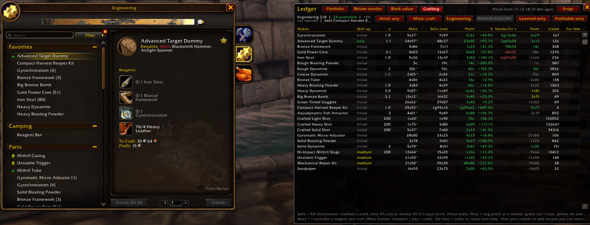

# Ledger

A small, **read-only** auction-house portfolio tracker for WoW: Forever (`## Interface: 16001`).



*The Crafting tab: what each recipe costs to make (crafting its parts when that's cheaper), what it sells
for after the AH cut, profit per craft and per hour, and the vendor floor.*

## Install

Download `Ledger-vX.Y.Z-forever.zip` from the [latest release](https://github.com/eogra7/Ledger/releases/latest) and
unzip it into `World of Warcraft\_forever_\Interface\AddOns\`, so you have `AddOns\Ledger\Ledger.toc`.
Optional, but Ledger is much more useful with them: AuctionDB or Auctionator (prices; Auctionator also for
shopping lists) and GearQuestForever (recipes you haven't learned yet). Open your profession window once so
Ledger records your recipes. Untested alphas (`vX.Y.Z-alpha.N`) are also on the
[releases page](https://github.com/eogra7/Ledger/releases) for anyone who wants to try changes early.

Contributing: pull requests are welcome; see [CONTRIBUTING.md](CONTRIBUTING.md) for the tests
(`lua tests/run.lua`), how to try a pull request's build in game, and how releases are made.

## What it does

It never buys, sells, posts, cancels or mails anything. It only reads:

- AH mail invoices (`GetInboxInvoiceInfo`) for purchases and sales: these are the source of truth for trades
- bag, bank (while the bank is open) and mailbox contents, to count holdings
- AHDB / AuctionDB's full scans (`AuctionDBForeverSaved.houses[house]`, v0.6) and Auctionator's public API
  (`Auctionator.API.v1`, caller id `"Ledger"`) for prices
- commodity purchase clicks (post-hooks on `C_AuctionHouse.StartCommoditiesPurchase` /
  `ConfirmCommoditiesPurchase` plus the `COMMODITY_*` events). These are kept as an audit
  trail and used to cross-check invoice prices. They are never counted as trades.

Files: `Ledger.toc`, `Core.lua` (data, events, commands), `Live.lua` (live AH search prices),
`Craft.lua` (recipes and crafting margins),
`UI.lua` (window).

## Commands

| Command | What it does |
|---|---|
| `/ledger` | Show or hide the portfolio window (also the minimap button). Drag to move, Esc to close |
| `/ledger snap` | Read prices from Auctionator now, recount bags (and bank if open) |
| `/ledger target cash <n>` | Cash target, % of total wealth (default **10**). Tile is green at/above, red below |
| `/ledger target cap <n>` | Max share per item and per category, % of market value (default **25**) |
| `/ledger target sell <n>` | Sell signal: price x 0.95 >= avg cost x (1 + n/100) (default **15**) |
| `/ledger cat <itemID> <category>` | Set an item's category (new items start as `Other`) |
| `/ledger use <itemID> <qty> [reason]` | Items used up crafting (reason defaults to your main profession: the first one whose window you've opened, else `Engineering`). Removed at average cost, so realized P/L doesn't change; the cost adds to `used[reason]`, shown in the footer. Same as right-click > Mark as used |
| `/ledger consume <itemID> <qty> [reason]` | Same as `use` with no default reason (e.g. quest turn-in). Logged as a `consume` trade |
| `/ledger source auto\|ahdb\|auctionator` | Where prices come from (default `auto`). With no argument, shows the current source, AHDB's scan count and last scan time, and whether Auctionator is loaded |
| `/ledger vendor` | Look up vendor sell prices for every item in the Auctionator scan (first run takes ~30s), then list the top 10 items whose lowest buyout is below what a vendor pays. Also runs silently ~10s after each scan; results show on the window's Below vendor tab |
| `/ledger vendorprice [<item> <amount>\|reset]` | (v0.8.2) Correct a vendor price the item data gets wrong, e.g. `/ledger vendorprice 4390 1s25`; `0` means vendors won't buy it, `reset` removes your correction. With no arguments it lists the corrections. Selling an item to a vendor also corrects it automatically |
| `/ledger exclude <itemID>` | Leave an item out of the portfolio (same as right-clicking its row). Its position and trades are kept |
| `/ledger include <itemID>` | Bring an excluded item back |
| `/ledger excluded` | List excluded items with their ids |
| `/ledger loan <name> <amount> <fee> [days]` | Record gold borrowed from another player, e.g. `/ledger loan Alex 4g 1g 7`. Amounts take `4g`, `4g50s`, `75s`, `1.5g` or a bare number of gold; days default to 7. Ledger can't see trade-window gold, so loans are entered by hand |
| `/ledger repay <name\|#id> [amount]` | Record paying a loan back: all of it, or part when an amount is given. The name can be left out when only one loan is open |
| `/ledger loans` | List open loans with what's owed and when, plus total fees paid |
| `/ledger craft [n] [profession]` | Add `tailoring`, `engineering` etc. to list one profession (v0.8.7). Most profitable crafts from your recipes at current prices (top 8 by default), plus items that are cheaper to buy than to craft. Open your profession window once so Ledger knows your recipes. Also on the window's **Crafting** tab |
| `/ledger craftmode cheapest\|ah\|craft` | (v0.8.8) Where reagents come from: whichever costs less (default), buy every reagent on the AH, or craft every part you have the recipe for. Same as the **Mats** button on the Crafting tab |
| `/ledger anvil [on\|off]` | (v0.8.14) `off` = no-anvil mode: hide recipes that need an anvil and buy those parts instead of crafting them (for crafting at the AH). No argument toggles. Same as the **Anvil** button on the Crafting tab |
| `/ledger craftdepth <buy> [skip]` | (v0.8.3) Crafting prices: reagents at the average of the cheapest `buy` units (default 20), products at the price past the cheapest `skip` units (default 5), so a few units listed absurdly cheap don't distort the numbers |
| `/ledger craft new [n]` | Profitable recipes you haven't learned yet. Ones you have the skill for come first, with where to get them (trainer and its cost, or a recipe item) and how many crafts pay back the training |
| `/ledger minimap` | Show/hide the minimap button (drag it around the minimap edge) |
| `/ledger help` | List the commands and the current targets |

Targets are saved in `LedgerDB.settings` as whole percentages.

## The window (v0.2)

Fixed size, 860 x 640. It remembers its position.

- **Header:** Snap button and price freshness: "Prices from <time>". The time is the last Auctionator scan or
  search Ledger saw, or failing that the newest same-day price it stored. It turns orange after 12 hours.
- **Takeaway line:** unrealized % after the cut, largest category and largest item with their shares, how many
  items/categories are over the cap, whether cash is above or below target, and the number of sell signals.
- **Tiles:** Total wealth (holdings at market + cash), Cash (share of wealth vs target), Holdings (market),
  Cost basis, Unrealized (copper and %, after the 5% cut, priced items only), Realized to date, and the
  positions and categories count.
- **Allocation by category:** horizontal bars (share of market value) labeled with % and value. The orange
  tick marks the cap, and the bar turns red when over it.
- **Positions table** (scrolls with the mouse wheel; click a header to sort, click again to reverse; the sort
  is saved):
  - Columns: Item, Category, Qty (`10 (10 AH)` when listed; an orange `*` means the counted bags+bank+mail+AH
    differ from the ledger qty), Price each, Cost basis, Market value, Unrealized, %.
  - Gain: a diverging green/red bar scaled to the largest |%|.
  - Trend: a sparkline of the last 7 AHDB scans (or up to 7 stored daily mins without AHDB), with the %
    change across them.
  - Flags: `SELL` (sell signal met, item name turns green) and `CAP` (item over the cap).
- **Right-click a row** for a small menu:
  - **Mark as used (<your profession>)...** asks how many, pre-filled with the shortfall when Ledger counts fewer
    than it has recorded. They leave the position at average cost (no profit or loss), and the footer
    shows a running "Used for Engineering" total.
  - **Exclude from portfolio...** (asks first). Excluded items leave every total, tile, category bar and
    rule; the footer shows how many are excluded. Use this for things that aren't investments, like
    crafted Engineering parts.
- **`USED?` flag:** shown when bags + bank + mail + AH add up to fewer than Ledger's qty, once the bank has
  been counted at least once. It's only a hint. Open the bank first so the count is current, then confirm
  with Mark as used.
- **Row tooltip:** avg cost, net sell price, the price needed for the sell signal, bags/bank/mail/AH
  counts, and the daily min prices.
- **Footer:** current targets and realized profit.

Prices update automatically when an Auctionator scan or search finishes (`RegisterForDBUpdate`) and when
the AH closes.

### Tabs (v0.3)

Two buttons beside the title switch between **Portfolio** (everything above) and **Below vendor**. The
last tab used is saved in `ui.tab`.

- **Below vendor:** items whose Auctionator lowest buyout is under what a vendor pays for them.
  - Summary line: how many there are, when they were last checked, and how many vendor prices are known.
  - **Check now** looks up vendor prices for any new scanned items and re-checks. This also happens
    automatically after each scan.
  - Table columns: Item, AH lowest, Vendor pays, Gain each (vendor minus AH), Gain %, Seen (today or
    1d ago). Click a header to sort; the sort is saved in `ui.vSortKey` / `ui.vSortAsc`, default Gain each,
    highest first.
  - Hover a row for the item tooltip plus the prices. Shift-click a row to put the item link in chat.
  - **Click a row (v0.8.4)** to open the item in the AH's own buy screen, the same way Auctionator does
    (`AuctionHouseFrame:SelectBrowseResult`). For commodities, the quantity starts at the number of units
    listed under vendor price. **Ledger doesn't buy anything:** you check the price, change the quantity if
    you like, and click Buy yourself. Clicked while the AH is closed, it opens the item when you next open
    the AH. The first click on an item may take a moment while the AH loads its info. Shift-click still
    links the item in chat.
  - **Vendor price corrections (v0.8.2):** the client's item data is wrong for some items on Forever. Iron
    Grenade's says 5s00, but vendors pay 1s25. Ledger uses, in order:
    1. Your corrections (`vendorFix`). When you right-click a stack to sell it at a merchant, Ledger compares
       the gold you got with what it had, and saves a correction if they differ ("vendors pay 1s25 each, not
       5s00 - vendor price corrected"). It only learns from one sale at a time, within 2 seconds. You can
       also set one with `/ledger vendorprice`.
    2. Built-in corrections (Iron Grenade 1s25).
    3. Items AHDB has marked as refused by vendors, which count as 0.
    4. The item data.
    Corrections are written over the vendor price cache at login and whenever one changes, so Below vendor,
    Bank value, Crafting and the vendor floor all use them.
  - **Listing counts (v0.7.5):** after each full AHDB scan, Ledger keeps every item's cheapest price levels
    (`listings`). It reads them from the scan AHDB hands to other addons when it finishes, so AHDB's
    "Record full scans" option isn't needed. Three extra columns use them:
    - **At price:** listings (units) at the lowest buyout, e.g. `3 (41)`.
    - **Under vendor:** every unit priced below the vendor price, across all price levels.
    - **Total gain:** what buying all of those and vendoring them would make.
    The summary line totals the whole tab ("buy all for X, vendor for +Y"). Hovering a row lists the cheapest
    price levels, green while they're under vendor price. `/ledger vendor` adds "N listings (units) at that
    price, M under vendor for +X in all". Counts are from the last scan, so some may have sold since.
- **Bank value (v0.4):** everything in your bank, not only portfolio items, with what it's worth.
  - The bank's full contents are recorded each time you open it (`bankItems`). Bags are recorded on every
    bag update (`bagItems`). The **Bank only / Bank + bags** button switches between them (`ui.bankBags`).
  - Each item is valued at its Auctionator lowest buyout × count. Soulbound items, and items with no AH
    price, use the vendor price instead. Summary line: total, the AH and vendor parts, item count, and
    when the bank was last seen.
  - Columns: Item, Qty, Each, Value, Priced by (AH / vendor / vendor (bound) / none), Seen. Click a header
    to sort (`ui.bSortKey` / `ui.bSortAsc`, default Value, highest first). The tooltip also shows the value
    after the 5% AH cut.

### Prices from AHDB (v0.6)

AHDB (the AuctionDB addon, "Auction House DataBase") records every full AH scan: for each item, the lowest unit
buyout, the median buyout and how many are listed. It keeps each scan for the last 7 days (up to 30), then
one rollup per day for 180 days. Ledger reads that data and never writes to it.

- **Source** (`/ledger source`, saved as `settings.source`):
  - `auto` (default): use AHDB's latest price for an item when it's at least as fresh (in days) as
    Auctionator's, otherwise use Auctionator.
  - `ahdb` / `auctionator`: use only that one.
- The price is AHDB's **min** (lowest buyout) from the last scan that saw the item, the same kind of
  price Auctionator gives. The scan's median and listed count are saved alongside it in `latest`.
- The same price is used everywhere: positions, Bank value and Below vendor. The vendor-price lookup also
  covers items that only AHDB has seen.
- **Trend** sparkline: one point per AHDB scan (the last 7) when there are at least 2. Otherwise it falls
  back to Ledger's stored daily mins. The row tooltip lists each scan as min / median (listed).
- **Row tooltip:** the lowest buyout, where it came from (`AHDB scan 11-10 21:14` or `Auctionator`), and
  the median with the listed count.
- **Freshness:** "Prices from" uses whichever is newer, AHDB's last scan or the last Auctionator scan.
- When AHDB finishes a scan (its `SCAN_DATA` notification), Ledger re-reads prices and re-checks Below
  vendor, just as it does after an Auctionator scan.

### Crafting (v0.7)

Profit per craft for the recipes you know, at current prices. It's in `Craft.lua` and the **Crafting** tab.

- **Professions (v0.8.7, Blacksmithing v0.9.0):** Engineering, Tailoring and Blacksmithing. The tab shows
  your profession by default: the first one whose window you've opened (Engineering before you open any). The
  profession button (left of Refresh from AH) cycles through yours first, then the others, then All. Before
  you open a profession's window it only has GearQuest's gear recipes, as not learned; open it once to record
  what you know. Recipes from any other profession window you open are recorded too. Ledger's built-in
  Engineering guesses only stand in until you open any profession window. Almost every Blacksmithing recipe
  needs an anvil, so **No anvil** mode hides nearly all of them.
- **Mats mode (v0.8.8):** the **Mats** button switches how reagents are sourced. *Cheapest* buys or crafts
  each part, whichever costs less. *Buy AH* buys every reagent and only crafts what can't be bought.
  *Craft* crafts every part you have the recipe for, unless a vendor sells it for less. Mats, Profit and
  the tooltip follow the mode; in the other modes the tooltip also shows what the cheapest mix would cost.
- **Compact tooltip (v0.8.8):** one line per reagent and part, with pay-at-most only for the top-level
  reagents. Hold **Shift** over a row to also see buy-vs-craft prices, batch prices and pay-at-most for
  every part.
- **No anvil (v0.8.14):** the **Anvil: any / No anvil** button (or `/ledger anvil off`) hides recipes that need
  an anvil, and parts that need one are bought instead of crafted, so the list is what you can make where you
  stand (e.g. at the AH). Tools are read from the profession window (`tools`, `anvil`, `toolsRead` on each
  recipe), so open it once after updating; recipes not read from a window (GearQuest, trainer, built-in) are
  kept. The tooltip shows "Needs: Anvil, ..." for recipes with tools.
- **Vendor/hr (v0.8.11, vendor-only since v0.8.13):** profit per hour of crafting when you vendor everything
  you make: (what a vendor pays for the craft - mats) / time per craft x 3600. Blank for items a vendor won't
  buy. AH prices aren't used, so it doesn't depend on anything selling. Time per craft is the
  cast time plus the casts of the intermediate parts you craft (per the Mats mode, at their average yield).
  Ledger times your real casts while the profession window is open (saved in `craftTimes[product] =
  {n, total, t}`). Per hour stays blank until the recipe and every part it crafts have been timed (v0.8.12);
  the tooltip lists which ones still need a craft with the window open.
  Only crafting time counts, not buying, posting or waiting for sales.
- **Shopping list (v0.8.9):** right-click a row > *Shopping list: 1x*, *10x*, *20x*, *50x* or *100x* (20/50/100 added in v0.8.10). Each option shows its total cost (AH + vendor reagents at current prices; an
  orange ? means some reagent has no price and isn't counted). Ledger makes an Auctionator
  shopping list "Ledger: <item>" with every reagent to buy on the AH and how many, following the Mats mode:
  parts you craft are broken down into their own reagents, rounded up to whole crafts at the average yield.
  With the AH open it switches to Auctionator's Shopping tab and searches the list; otherwise it does that
  the next time you open the AH (within 30 minutes). Chat shows the list, plus what to get from a vendor.
  It only searches: you choose what to buy. It doesn't subtract what's already in your bags. Making a list
  again for the same item replaces it.
- **Alt-click a row** (v0.8.6) to open AuctionDB's price history graph for the crafted item. Works on
  the Below vendor and Bank value tabs too.
- **Recipes:** each time you open a profession window, Ledger records every recipe in it: the product,
  how many one craft makes, the reagents, and the skill-up color. They're saved in `recipes`. Until you've
  opened your Engineering window once, Ledger uses a short built-in Engineering list (14 recipes, skill 1 to
  125). Those reagents are from memory and may be wrong, so the tab and chat warn about it.
- **Math:** profit = min(AH lowest, median) × yield × 0.95 − mats. Prices come from the same source as
  everything else (`/ledger source`). Each reagent costs its AH lowest buyout, or the vendor price for trade
  supplies like Weak Flux or Wooden Stock, whichever is cheaper. A reagent with no price shows as `?`, and
  that recipe gets no profit figure.
- **Recipes you haven't learned (v0.7.1):** click **Learned only** to switch to **+ Not learned**. These come from:
  your trainer (open the trainer window: every recipe it lists is saved with its training cost and skill
  needed; tick the trainer's "unavailable" filter to include higher ones), GearQuestForever's recipe data
  (gear recipes, from Wowhead Forever) when that addon is loaded, and the built-in Engineering list. Their
  rows are grey. The Skill-up column says `learn 145`: green when your skill is high enough now, red when it
  isn't yet. The tooltip shows where to get the recipe and, for trainer recipes, after how many crafts the
  training pays for itself.
- **Chat:** Ledger announces your recipes once, the first time it reads a profession window, and after
  that only when you learn new ones.
- **Vendor floor (v0.7.2):** each product's vendor sell price (from `GetItemInfo`, cached in `vendor`) is
  checked too. **Sells** uses whichever pays more for the whole craft: the AH after its 5% cut, or a vendor
  (marked `V`, no cut, no waiting). **Floor** = vendor price × yield − mats: what you'd make selling to a
  vendor. Green means the craft can't lose money, because anything that doesn't sell on the AH can go to a
  vendor. A recipe with no AH price still gets a profit if a vendor buys it. Chat says "to a vendor (no
  risk)" or "on the AH (vendor floor X)".
- **Variable yield (v0.7.3):** some recipes make a range (Heavy Dynamite: 1-5). Ledger prices them at the
  average, shown grey in the `x` column with `x1-5 (avg 3.0)` in chat. **Floor** is the *average* vendor
  profit. It's green only when even a craft that makes the minimum covers the mats, and yellow when it's
  profitable on average but a single unlucky craft can lose. The tooltip shows that "unlucky craft" figure.
- **Yield tracking (v0.7.3):** craft with your profession window open, and Ledger counts how many items each
  craft actually put in your bags. It saves this in `yields[product] = {n, made, min, max, t}` and blends it
  with the recipe's average, weighted as if the recipe's average were 5 crafts. So one craft of 4 from a 1-5
  recipe moves 3.00 to 3.17, and the observed average takes over as you craft more. "Create all" chains are
  counted per craft. Nothing is recorded when your bags are full (items go to the mail) or when more than one
  product changed. Once an item has observed yields, the `x` column turns white, and the tooltip shows
  "your crafts: avg from N".
- **Make or buy (v0.7.4):** a reagent you can craft yourself (a recipe you've learned) costs the cheaper of
  buying it and crafting it from its own reagents, which are priced the same way, up to 3 levels deep. Take
  Heavy Dynamite: if Heavy Blasting Powder gets expensive on the AH but Heavy Stone doesn't, Ledger prices
  the powder at Heavy Stone ÷ the powder recipe's yield. The dynamite then stays profitable as long as
  crafting the powder yourself keeps it so. On the tab, Mats gets a green `*`. The tooltip shows the crafted
  reagent in green, what buying it would cost, its own sub-reagents, and "Crafting the green ones yourself
  saves X per craft". Chat adds "craft your own Heavy Blasting Powder (saves X)". It doesn't count the time
  for the extra crafts, or the money you'd get selling the intermediate instead.
- **Live prices (v0.8):** with the auction house open, click **Refresh from AH** on the Crafting tab. Ledger
  searches every product and reagent the tab shows, including make-or-buy sub-reagents and skipping vendor
  trade supplies, one at a time at about a second each, most profitable recipes first. Click again to stop.
  It only searches, never buys. It waits while AHDB is scanning or another addon has just queried the AH, and
  sets `AuctionDB.ahBusy` while it runs so AHDB's own live searches wait for it too. Searches made by anything
  else (the Blizzard AH, Auctionator, AHDB) are recorded as well. Results go to `live` in `Live.lua`. A live
  price newer than AHDB's last scan, and at most 6 hours old, takes over everywhere prices are used:
  portfolio, crafting, bank and below vendor. The summary shows "N live (Xm ago)", and a row's tooltip says
  "Price from live AH search, 2m ago" or "AHDB scan, 3h ago".
- **Pay at most (v0.8.1):** under each reagent in the tooltip, including sub-reagents down a make-or-buy
  chain, is the most you can pay for one before the craft stops making money, with everything else at
  today's price. The first figure assumes you vendor the product, which is guaranteed. The second assumes you
  sell it on the AH, when that pays more. Sub-reagents show how many a craft uses, e.g. "pay at most (2 per
  craft)" for Heavy Stone. A green-grey line means today's price is under the limit; red means it's over.
  Heavy Dynamite, for example, at an average of 3 per craft: Heavy Stone up to 4s87 vendoring or 6s39 on the
  AH, Wool up to 4s32 or 7s35.
- **Depth pricing (v0.8.3):** one or two units listed absurdly cheap no longer set the price. Using the
  listing levels from the last AHDB scan or a live search, Ledger prices:
  - **Reagents** at the average of the cheapest 20 units, which is what buying for a batch really costs.
    The tooltip shows "avg of cheapest 20 / lowest X" when that's higher than the single lowest listing.
  - **Products** at the price after skipping the cheapest 5 units, still capped at the median. Stragglers
    get bought out, and the price you compete with is above them. The tooltip shows "using, past the 5
    cheapest units".
  - Change both with `/ledger craftdepth <buy units> [skip units]`. For example, `/ledger craftdepth 60 10`
    if you craft in bigger batches.
  - The scan now keeps each item's cheapest price levels until at least 200 units are covered (up to 25
    levels). Without listing levels for an item, the lowest buyout is used as before.
- **Vendor-sold reagents (v0.8.5):** open any merchant and Ledger records everything it sells for gold in
  unlimited stock, at the price you pay (reputation discounts included), per unit (`vendorBuy`). Those
  prices win over Ledger's short built-in list of trade supplies, so Rough and Coarse Blasting Powder from
  the Engineering supplier are priced at the vendor whenever that's cheaper than the AH or crafting them.
  When a merchant sells something your recipes use, chat says so once: "vendor sells reagents you use:
  Coarse Blasting Powder 40c, ... (crafting prices updated)". Limited-stock and token-cost items are
  skipped. Vendor-bought reagents are also left out of **Refresh from AH** searches.
- **Red rows** cost more to craft than to buy. If you need that item for something else, buy it.
- **For fees:** with a loan open, this column shows how many crafts would cover the loan's fee.
- **`/ledger craft [n]`** prints the top n crafts (default 8) and the "cheaper to buy" list in chat.
- Prices are listings, not sales. Before making many, check how fast an item actually sells.

### Loans (v0.5)

- What a loan costs you in total (principal + fee) counts as debt **from the day you take it**. It comes off
  Cash (which can go below zero, shown in red) and Total wealth. So a 4g loan with a 1g fee drops your wealth
  by 1g straight away, and the cash target is checked against your gold after debts.
- Cash tile: gold after debts, with "owe X" under it. The takeaway line shows the soonest-due loan (orange,
  red when overdue). The footer shows the total owed.
- Repayments pay off the principal first, then the fee. Fees paid add to `loanFees`, shown under the Realized
  tile as "fees -X". Realized trading P/L itself doesn't change, so you can compare the two to see whether
  the loan paid for itself.
- At login, Ledger prints a reminder in chat for loans due within a day or overdue.

## How trades are recorded (and why there are no duplicates)

- A trade is written only when an AH invoice mail (`buyer` or `seller`) first appears in your inbox.
  Failed or repeated clicks produce no mail, so they produce no trade. Pending-sale mails
  (`seller_temp_invoice`) are ignored. The final `seller` mail is the one that counts.
- Each invoice is identified by a signature (type, item name, bid, buyout, deposit, cut, count fields)
  plus the mail's estimated expiry time (`now + daysLeft`). Re-opening the mailbox, `/reload` or
  relogging matches the same mail again (±30 min tolerance) and records nothing new. When a mail leaves
  the inbox it is marked `gone` and can't absorb a later identical invoice.
- **First run:** AH invoices already in your mailbox the first time Ledger reads it are *not* recorded,
  because the seed cost basis may already include them. They are listed in chat and saved in
  `LedgerDB.skipped`. The exception is a buyer invoice that matches an unmatched purchase click made
  after `seeded` (same qty, same total, same item name when known). That's a real new buy, so it is
  recorded and the click is marked `matched`.
- **v0.1.1 repair (runs once at login):** `skipped` buyer entries that match an unmatched post-seed click are
  applied as buys (`repaired = true` on the trade, `applied = true` on the skipped entry). Completion is
  stored in `repairs.skippedClicks`.
- **Doubled values:** Journalator stored about 2× values on this client. Ledger guards against that:
  - **Sales:** net = the money actually attached to the mail. Gross = net + cut − deposit. If that
    differs from the invoice's `bid`, the trade gets `fixed = "money"` and `grossRaw = bid`.
  - **Buys:** if a matching observed click (same item and qty, within 24h) shows the invoice is exactly
    2× the quoted total, the click total is used, and the trade gets `fixed = "click"` and
    `grossRaw = bid`.
  - Every trade also stores `raw`, the invoice's raw return values, so it can be checked later.
- Quantity: buys use the attachment stack count(s). Sales use invoice return #11 (falling back to #10).
  `countIdx` records which one was used. If neither exists, qty is set to 1 and `qtyGuess = true`.

Cost basis uses the **average-cost** method. A buy adds its qty and total cost to the position. A sale
removes qty at the average cost (`basis`) and realizes `net - basis`. Selling more than the ledger holds
removes the whole position, and the extra units count at zero basis. Sales of items Ledger doesn't
track are logged with `untracked = true` and don't count toward realized P/L.

## SavedVariables format

File: `WTF\Account\<account>\SavedVariables\Ledger.lua`. It's written on `/reload` or logout and holds
one account-wide global in plain Lua tables, with no compression or serialization libraries. All money
values are in **copper**. Times are Unix epoch seconds (`time()`), and days are local `YYYY-MM-DD`.

```lua
LedgerDB = {
  version = 1,
  seeded = 1762570000,          -- when tracking started (purchases clicked before it are baseline)
  mailBaselined = 1762570100,   -- first complete inbox read (see "First run")
  lastSnap = 1762570200,        -- last price snapshot
  realized = 292,               -- total realized P/L, copper

  positions = {                 -- open + closed positions, keyed by itemID
    [4338] = { name = "Mageweave Cloth", category = "Cloth", qty = 6, cost = 4788, realized = 0 },
    -- avg cost = cost / qty; a sold-out position stays with qty = 0, cost = 0
  },

  trades = {                    -- append-only, chronological
    { t=..., type="buy", itemID=2840, name="Copper Bar", qty=20, unit=72, gross=1440, cut=0, deposit=0 },
    { t=..., type="buy",  itemID=3860, name="Mithril Bar", qty=2, unit=1500, gross=3000, cut=0, deposit=0,
      invoiceKey="buyer|Mithril Bar|...|1765162000", seller="Name", mailT=..., raw={...},
      clickTotal=3000,          -- optional: matched observed purchase
      fixed="click", grossRaw=6000 },  -- optional: only when a correction was applied
    { t=..., type="sell", itemID=4338, name="Mageweave Cloth", qty=2, unit=1100, gross=2200, cut=110,
      deposit=30, net=2120, basis=1596, realized=524, invoiceKey="...", buyer="Name", mailT=...,
      countIdx=11, raw={...} },  -- optional: fixed="money", grossRaw, qtyGuess, untracked
    { t=..., type="consume", itemID=8150, name="Deeprock Salt", qty=5, basis=1908, gross=0, cut=0, deposit=0 },
  },
  -- type is one of "seed" (pre-0.9.1 only) | "buy" | "sell" | "consume". To rebuild positions, replay them in order
  -- with average cost. "seed" behaves like "buy"; "consume" removes `basis` with no proceeds.

  prices = {                    -- per-item daily history, last 21 days, oldest first
    [4338] = { { day="2026-11-07", min=950, last=980, time=... }, ... },
    -- min = lowest Auctionator price seen that day; last = most recent. A day is written only when
    -- Auctionator saw the item that day (age 0), so stale prices never fill in missing days.
  },

  latest = {                    -- most recent Auctionator price per item, whatever its age
    [4338] = { price=980, age=0, t=..., src="ahdb", median=1020, listed=9711, scanT=... },
    -- age = days since the source last saw it (nil = >21 or never); src = "ahdb" | "auctionator";
    -- median / listed / scanT only for AHDB prices (scanT = that scan's time)
  },

  holdings = {                  -- per tracked item
    [4338] = { bags=6, bank=0, mail=0, auctions=0, t=..., bankT=..., mailT=..., auctionsT=... },
    -- bank is only refreshed while the bank is open (bankT); mail only on a complete inbox read (mailT);
    -- auctions = your active (unsold) AH listings, refreshed whenever the AH UI loads your owned-auctions
    -- list (OWNED_AUCTIONS_UPDATED), e.g. Auctionator's Selling/Cancelling tab. Ledger never queries it itself.
    -- Sold-but-not-yet-mailed auctions are in none of these until the seller invoice arrives.
  },

  invoices = { ["<signature>"] = { {exp=..., t=..., gone=true}, ... } },  -- dedupe bookkeeping
  clicks   = { {t=..., itemID=..., qty=..., unit=..., total=..., matched=false}, ... },  -- last 7 days
  skipped  = { {t=..., invoiceKey=..., raw={...}, money=..., applied=true?}, ... },  -- first-run baselined invoices
  repairs  = { skippedClicks = 1794120000 },  -- one-time migrations already run
  ui       = { point = {"CENTER", "CENTER", 0, 0}, sortKey = "value", sortAsc = false,
               minimapAngle = 210, minimapHidden = false },
  settings = { cash = 10, cap = 25, sell = 15,    -- whole percentages; missing keys use these defaults
               source = "ahdb" },                 -- v0.6: "ahdb" | "auctionator"; missing = auto
  lastScan = 1794120000,        -- last Auctionator scan/search completion Ledger observed (freshness)
  vendor   = { [4338] = 200, ... },  -- v0.3: vendor sell price per item (copper; 0 = not sellable).
                                     -- Looked up once per item from GetItemInfo; sell prices don't change
  excluded = { [4371] = true },  -- v0.3: items left out of the portfolio (position/trades kept)
  used     = { Engineering = 1465 },  -- v0.3: cost basis used up, by reason (consume trades carry `reason`)
  vendorScan = 1794120000,      -- when the last vendor price lookup finished
  belowVendor = { t = 1794120000,    -- last below-vendor check, best gain first
                  items = { {id=..., name=..., ah=..., vendor=..., gain=..., age=...}, ... } },
  bankItems = { t = 1794120000, items = { [2592] = {n = 77}, [6948] = {n = 1, bound = true}, ... } },  -- v0.4
  bagItems  = { t = 1794120000, items = { ... } },  -- v0.4, same shape
  loans     = { { id = 1, who = "Alex", principal = 40000, fee = 10000, paid = 0,   -- v0.5
                  t = 1794120000, due = 1794724800, repaid = nil }, ... },  -- repaid = time once fully paid
  loanFees  = 0,                -- v0.5: fees paid on loans so far, copper
  recipes   = { [4373] = { product = 4373, name = "Shadow Goggles", prof = "Engineering", yield = 1,  -- v0.7
                  difficulty = "optimal", reagents = { {2319, 4}, {1210, 2} }, t = 1794120000 }, ... },
                -- keyed by product itemID; read from your profession windows
  recipeProfs = { Engineering = { t = 1794120000, rank = 127, n = 42 } },  -- v0.7: last read per profession
  listings  = { t = 1794120000, items = { [2589] = "3,1,200 4,1,50 5,1,10" } },  -- v0.7.5: price,auctions,units
                -- cheapest levels per item from the last AHDB full scan (kept while under vendor price)
  live      = { items = { [2838] = { t = 1794120000, min = 250, median = 300, qty = 650,   -- v0.8: AH searches
                  levels = "250,2,50 260,1,100", full = true }, ... } },  -- {t, none = true} when none listed
  vendorBuy = { [4364] = { price = 40, merchant = "Engineering Supplier", t = 1794120000 } },  -- v0.8.5
  vendorFix = { [4390] = 125 },  -- v0.8.2: your vendor price corrections (copper; 0 = vendors won't buy)
  yields    = { [4378] = { n = 3, made = 11, min = 2, max = 5, t = 1794120000 } },  -- v0.7.3: your crafts' output
}
```

In `raw`, a nil return is stored as `false`. The order follows `GetInboxInvoiceInfo`: invoiceType,
itemName, playerName, bid, buyout, deposit, consignment (AH cut), then client-specific fields
(moneyDelay, etherealDelay, count, ...).

Tracked items are every key in `positions`: anything Ledger has seen bought. A new install starts empty
(v0.9.1; earlier versions gave every install the author's starting positions, and v0.9.1 removes them once
at login from any install created after the author's own).

## Test plan (in game)

1. Log in. There should be no Lua error, and `/ledger help` should print the commands. (Turn on Lua errors
   with `/console scriptErrors 1` if needed.)
2. `/ledger`. On a new install the portfolio is empty until you buy something on the AH. Prices show
   "no data" until Auctionator has prices. Visit the AH, run an Auctionator scan, then `/ledger snap`.
3. Open your mailbox once. Any AH invoices already there should appear as "baseline: ... not recorded".
4. Buy **one cheap stack** of something on the AH (ideally a tracked item, e.g. 1 Bruiseweed). Note the exact
   price you paid. If the buy fails and you click again, that's fine; it's part of the test.
5. Open the mailbox. Chat should say `recorded buy: 1x ... for <price>`, exactly once. Close the mailbox and
   open it again: nothing new should be recorded. Take the item.
6. `/reload`, then open the window again: qty and avg cost should include the purchase once.
7. Open `WTF\Account\<account>\SavedVariables\Ledger.lua` and check that the last `trades` entry has the right
   `qty` and `gross` (the price you paid, not 2×). If it has `fixed = "click"`, the doubled-value guard
   kicked in. Report that, along with the `raw` values.
8. Later, when something sells, check the `sell` trade: `net` should equal the gold you received.
9. (v0.3) `/ledger vendor`. Chat should say "looking up vendor prices...", then after ~30s list items below
   vendor price (or say there are none). Hover one listed item: its vendor price in the tooltip should match.
   Run it again: it should finish almost at once (prices are cached). `/reload` and check that
   `Ledger.lua` now has `vendor` and `belowVendor`.
10. (v0.3) `/ledger`, click **Below vendor**. The same items should be listed with real names, not
    "item 7608". Click **Check now**, sort by a header, hover a row (item tooltip) and shift-click one (link
    in chat). Switch back to **Portfolio**: tiles, bars and the table should all come back. `/reload` with
    the window on Below vendor; it should reopen on that tab.
11. (v0.3) Open the bank, then `/ledger`. Copper Bar should show `USED?` and an orange `*` if bars are gone.
    Right-click it > Mark N as used, accept. Chat should say `used Nx Copper Bar for Engineering (cost ...)`,
    the row's qty should drop, Realized should stay the same, and the footer should show "Used for
    Engineering". Right-click elsewhere, or press Esc, to close the menu without doing anything.
12. (v0.4) `/ledger`, click **Bank value** before opening the bank: it should say to open the bank. Open the
    bank: the list should fill in with every bank item, highest value first. Wool and Linen should be priced
    by AH; a soulbound item should say "vendor (bound)". Click **Bank only** to switch to Bank + bags; the
    total should rise. Hover a row for the AH, vendor and after-cut values.
13. (v0.5) `/ledger loan Alex 4g 1g 7`. Chat should confirm loan #1, "you owe 5g00s00, due in 7d", and the
    1g break-even line. `/ledger`: Cash should be 5g less than the gold in your bags, with "owe 5g00s00" under
    it. Once Alex's 4g has arrived, Total wealth should be 1g lower than before the loan; the takeaway line and footer should show the loan. `/ledger repay Alex 2g`,
    then `/ledger loans`: 3g owed. `/ledger repay Alex`: repaid in full, and the Realized tile should
    show "fees -1g00s00".
14. (v0.6) `/ledger source`: it should say `auto`, with AHDB's scan count and last scan time. `/ledger`:
    "Prices from" should match AHDB's last scan. Hover Goldthorn: "from AHDB scan <time>", a median with
    the listed count, and up to 7 scan lines. Do a full AHDB scan: the window should refresh by itself a
    few seconds after "scan done". `/ledger source auctionator`: prices and trends should go back to
    Auctionator's. `/ledger source auto` restores AHDB.
15. (v0.7) `/ledger craft` before opening any profession window: it should list Shadow Goggles and Heavy
    Dynamite near the top, name a few "cheaper to buy than craft" items, and warn that the Engineering
    recipes are built-in guesses. Open your Engineering window: chat should say "recorded N Engineering
    recipes". `/ledger craft` again: no warning, and every row is a recipe you know. `/ledger`, click
    **Crafting**: the Skill-up column shows orange/yellow/green/grey, hover a row for reagent costs, and
    **Profitable only / All recipes** switches the list. With a loan open, "For fees" shows how many crafts
    cover its fee.
16. (v0.7.1) Open and close your Engineering window a few times, and craft something: no repeated "recorded
    ... recipes" lines. Visit your Engineering trainer, then `/ledger craft new`: trainer recipes show their
    cost, ones within your skill come first. On the Crafting tab, click **Learned only**: it should switch to
    **+ Not learned** and grey unlearned rows appear with `learn <skill>` in green or red.
17. (v0.7.2) Crafting tab: hover Heavy Dynamite. The tooltip should show both "AH, after 5% cut" and "Vendor
    pays" (3s50 each), and the Floor column should be about 70c with mats near 9s80 and 3 per craft.
18. (v0.7.3) Open Engineering and craft Heavy Dynamite once. A second later the Crafting tab's `x` value should
    move off 3.0 toward what you got, and the tooltip should say "your crafts: N avg from 1". Floor should be
    yellow (an unlucky craft of 1 loses), not green.
19. (v0.7.4) With Heavy Blasting Powder learned, hover Heavy Dynamite. If crafting the powder from Heavy Stone
    is cheaper than buying it, the powder line is green with "craft it", "buying it instead" shows the AH
    price, Heavy Stone is listed under it, and Mats has a green `*`.
20. (v0.7.5) Run a full AHDB scan, then open **Below vendor**. At price, Under vendor and Total gain should
    fill in, the summary should say "listings from scan Xm ago", and hovering a row should list the cheapest
    price levels. Compare one item with the AH: the number of auctions at the lowest price should match.
21. (v0.8) Open the AH, then **Crafting** > **Refresh from AH**. The button should count up ("Stop (5/30)")
    and chat should say "searching N items". When it's done, hovering a row should say "Price from live AH
    search". Search an item yourself in the AH: Ledger should pick that price up too. Closing the AH stops a
    refresh that's still running.
22. (v0.8.1) Hover Heavy Dynamite: each reagent has a "pay at most" line. Heavy Stone's should say "(2 per
    craft)" and match (vendor total − wool − other mats) ÷ 2.
23. (v0.8.2) Iron Grenade should no longer be on Below vendor (its AH price is above 1s25). Sell any item
    to a vendor: nothing is printed if its price was right. `/ledger vendorprice` lists Iron Grenade as
    "1s25 (built in)".
24. (v0.8.3) Find a product with one or two units listed far below the rest. After a full AHDB scan, its
    Crafting row should price it at the main price level, and the tooltip should say "using, past the 5
    cheapest units". A reagent with a cheap straggler should show "avg of cheapest 20". `/ledger craftdepth
    100 0` changes both, and `/ledger craftdepth 20 5` puts the defaults back.
25. (v0.8.4) At the AH, click an item on **Below vendor**: the AH should switch to that item's buy screen,
    with the quantity set to the "Under vendor" count for commodities. Nothing is bought until you click
    Buy. Click one with the AH closed, then open the AH: it should open that item.
26. (v0.8.5) Open the Engineering supplies vendor. Chat should list the reagents it sells that your recipes
    use (e.g. Rough/Coarse Blasting Powder) with prices. On the Crafting tab, recipes using them should show
    those reagents as "(… vendor)" in the tooltip when the vendor is cheapest.
27. (v0.8.6) Alt-click a row on **Crafting** (or Below vendor / Bank value): AuctionDB's price history
    graph should open for that item. Without AuctionDB loaded, chat says so instead.
28. (v0.8.7) The Crafting tab opens on **Engineering**. Click the profession button: Tailoring (with
    "+ Not learned", GearQuest's tailoring recipes appear), then All, then back to Engineering. Open your
    Tailoring window (if you have it) and its recipes show as learned. `/ledger craft tailoring` lists only those.
29. (v0.8.8) Hover Compact Harvest Reaper Kit: one line per part, no "buying it instead" lines. Hold Shift:
    the detail lines appear without moving the mouse. Click **Mats** to *Buy AH*: its mats rise and the
    tooltip says how much less the cheapest mix costs. *Craft*, then back to *Cheapest*.
30. (v0.8.9) At the AH, right-click Compact Harvest Reaper Kit > *Shopping list: 10x*. Auctionator's Shopping
    tab should open and search "Ledger: Compact Harvest Reaper Kit" (e.g. 60 Iron Bar, 7 Gold Bar, 40 Heavy
    Leather on Cheapest). With the AH closed, do the same, then open the AH: it should open the list.
    Hover a 3-level recipe: Gold Power Source now shows its Gold Bar under it (fixed in 0.8.9).
31. (v0.8.11) The Crafting tab has a **Vendor/hr** column, blank for recipes not timed yet (the tooltip says
    which crafts to time). Craft one with the profession window open: Vendor/hr fills in and the tooltip shows
    "Crafting time" with your real cast.
32. (v0.8.14) Open your Engineering window once, then hover a recipe that needs an anvil: the tooltip says
    "Needs: Anvil, ...". Click **Anvil: any** so it reads **No anvil**: those recipes disappear, the summary
    says "no anvil", and recipes using them as parts buy them on the AH instead.
